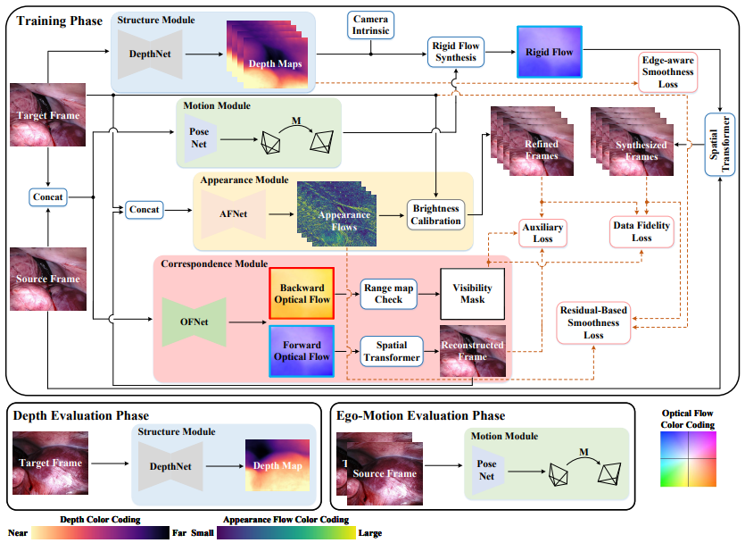

# AF-SfMLearner (Modified Fork)

This is a **modified fork** of the official PyTorch implementation for AF-SfMLearner. This version introduces several engineering improvements:
- **Unified Training Entrypoint:** A single `train.py` script replaces multiple separate scripts for different stages.
- **Type-Safe Configuration:** Uses Pydantic for robust, auto-validated training options in `options.py`.
- **Modern Tooling:** Integrated support for `uv` and cleaner dependency management.

---

This repository contains the code for training and testing depth estimation models using the method described in:

> **Self-Supervised Monocular Depth and Ego-Motion Estimation in Endoscopy: Appearance Flow to the Rescue**
>
> [Shuwei Shao](https://scholar.google.com.hk/citations?hl=zh-CN&user=ecZHSVQAAAAJ), Zhongcai Pei, [Weihai Chen](https://scholar.google.com.hk/citations?hl=zh-CN&user=5PoZrcYAAAAJ), [Wentao Zhu](https://scholar.google.com.hk/citations?hl=zh-CN&user=2hjYfqIAAAAJ), Xingming Wu, Dianmin Sun and [Baochang Zhang](https://scholar.google.com.hk/citations?hl=zh-CN&user=ImJz6MsAAAAJ)
>
> [accepted by Medical Image Analysis (arXiv pdf)](https://arxiv.org/pdf/2112.08122.pdf)

and 

> **Self-Supervised Learning for Monocular Depth Estimation on Minimally Invasive Surgery Scenes**
>
> [Shuwei Shao](https://scholar.google.com.hk/citations?hl=zh-CN&user=ecZHSVQAAAAJ), Zhongcai Pei, [Weihai Chen](https://scholar.google.com.hk/citations?hl=zh-CN&user=5PoZrcYAAAAJ), [Baochang Zhang](https://scholar.google.com.hk/citations?hl=zh-CN&user=ImJz6MsAAAAJ), Xingming Wu, Dianmin Sun and [David Doermann](https://scholar.google.com.hk/citations?hl=zh-CN&user=RoGOW9AAAAAJ)
>
> [ICRA 2021 (pdf)](https://ieeexplore.ieee.org/abstract/document/9561508).

#### Overview

<p align="center">
 
</p>

## ⚙️ Setup

We ran our experiments with PyTorch 1.2.0, torchvision 0.4.0, CUDA 10.2, Python 3.7.3 and Ubuntu 18.04.

```bash
# Recommended setup using uv
uv venv
source .venv/bin/activate
uv pip install -e .
```

---

## 💾 Dataset Preparation

### 1. Endovis (SCARED)
The dataset contains RGB videos and corresponding depth ground truth.
- **Download:** Request access via [Endovis/SCARED challenge](https://endovissub2019-scared.grand-challenge.org).
- **Preprocessing:** Convert `.mp4` videos to `.png` frames:
  ```shell
  find . -name "*.mp4" -print0 | xargs -0 -I {} sh -c 'output_dir=$(dirname "$1"); ffmpeg -i "$1" "$output_dir/%10d.png"' _ {}
  ```
- **Structure:**
  ```text
  /path/to/endovis_data/
    dataset1/
      keyframe1/
        image_02/
          data/
            0000000001.png
  ```

### 2. C3VDv2 (Colonoscopy)
A synthetic colonoscopy dataset with ground truth depth and pose.
- **Preprocessing:**
  1. **Compute Undistort Map:** 
     ```shell
     python scripts/compute_undistort_map.py --output_dir undistort_maps/
     ```
  2. **Generate Splits:**
     ```shell
     python scripts/generate_splits.py --data_root /path/to/C3VDv2 --output_dir splits/c3vdv2
     ```
     By default this uses the curated C3VDv2 regional protocol: train on `t1/t2`,
     validate on `t4`, and test on `t3`. To print the archive metadata indices
     for the matching download plan:
     ```shell
     python scripts/generate_splits.py --print_download_indices
     ```

### 3. REAL-Colon
A large-scale clinical colonoscopy dataset for self-supervised training.
- **Download:** Use the official helper repository: <https://github.com/cosmoimd/real-colon-dataset>.
- **Structure:**
  ```text
  /path/to/REAL-Colon/
    001-001_frames/
      001-001_1.jpg
      001-001_2.jpg
    001-001_annotation/
    video_info.csv
    lesion_info.csv
    dataset_description.md
  ```
- **Generate Splits:**
  ```shell
  python scripts/generate_splits_realcolon.py \
      --data_root /path/to/REAL-Colon \
      --output_dir splits/real_colon \
      --train_stride 10
  ```
  Split rows use the MonoDataset format `<sequence_id> <frame_index> l`
  and are written to `train_files.txt`, `val_files.txt`, and `test_files.txt`.

---

## ⏳ Training Instructions

You can use the unified `train.py` script for all datasets.

### A. Endovis (SCARED)
**Stage-wise fashion:**
1. **Stage One (Optical Flow):**
   ```shell
   CUDA_VISIBLE_DEVICES=0 python train.py --mode stage1 --data_path <your_data_path> --log_dir logs/endovis_s1
   ```
2. **Stage Two (Depth, Pose, Appearance Flow):**
   ```shell
   CUDA_VISIBLE_DEVICES=0 python train.py --mode stage2 --data_path <your_data_path> --log_dir logs/endovis_s2 --load_weights_folder logs/endovis_s1/models/weights_19
   ```

**End-to-end fashion:**
```shell
CUDA_VISIBLE_DEVICES=0 python train.py --mode end_to_end --data_path <your_data_path> --log_dir logs/endovis_e2e
```

### B. C3VDv2 Fine-Tuning
C3VDv2 uses a specific pipeline with supervised depth/pose loss ramping.

1. **Run Full Pipeline:**
   ```shell
   DATA_PATH=/path/to/C3VDv2 UNDISTORT_MAPS=undistort_maps/ bash scripts/run_finetune_c3vdv2.sh
   ```
2. **Manual Stage 2:**
   ```shell
   CUDA_VISIBLE_DEVICES=0 python train.py --mode c3vdv2_stage2 --dataset c3vdv2 --split c3vdv2 \
       --data_path /path/to/C3VDv2 --undistort_maps undistort_maps/ \
       --load_weights_folder logs/c3vdv2_stage1/models/weights_19/ \
       --w_depth_start 1.0 --w_depth_end 0.3 --w_pose_start 0.5 --w_pose_end 0.1
   ```

### C. REAL-Colon (Self-Supervised)
```shell
# HF-backed diagnostic from the current C3VDv2 Run D checkpoint
bash scripts/submit_real_colon_hf.sh

# Lanta/SLURM: run with bash on a login node so HF data is cached before sbatch
bash scripts/submit_real_colon_hf_lanta.sh

# Or call the reusable wrapper directly
DATA_SOURCE=hf HF_REPO_ID=SmartWhatt/real-colon-SfM \
LOAD_WEIGHTS_FOLDER=logs/c3vdv2_hf/stage2_specular_pps/models/weights_best \
bash scripts/run_finetune_real_colon.sh
```

`LOAD_WEIGHTS_FOLDER` supplies the frozen Stage 1 registration network. If the
same folder contains full Stage 2 weights, depth, pose, transform, and
SpecularNet are also warm-started without freezing for REAL-Colon adaptation.

---

## 📊 Evaluation

### Endovis Evaluation
1. **Prepare Ground Truth:**
   ```shell
   python tools/export_gt_depth.py --data_path endovis_data --split endovis
   ```
2. **Run Evaluation:**
   ```shell
   python tools/evaluate_depth.py --data_path <your_data_path> --load_weights_folder logs/endovis_s2/models/weights_19 --eval_mono
   ```

### C3VDv2 Evaluation
```shell
python tools/evaluate_c3vdv2.py --data_path /path/to/C3VDv2 --load_weights_folder logs/c3vdv2_stage2/models/weights_19/ --split c3vdv2
```

---

## 🖼️ Prediction

Predict scaled disparity for a single image or a folder:
```shell
CUDA_VISIBLE_DEVICES=0 python test_simple.py --model_path <your_model_path> --image_path <your_image_or_folder_path>
```

---

## 📦 Model zoo

| Model        | Abs Rel | Sq Rel | RMSE | RMSE log | Link |
| ------------ | ---------- | ------ | --------- | ---- | ---- |
| Stage-wise (ID 5 in Table 8) | 0.059 | 0.435 | 4.925 | 0.082 |[baidu](https://pan.baidu.com/s/1MT5RrbDl8Wh6otPihD0kEw) (code:n6lh); [google](https://drive.google.com/file/d/14VFlTHq6raQkdyCRBCQYV-mbFO4eOM5b/view?usp=sharing)|
| End-to-end (ID 3 in Table 8) | 0.059 | 0.470 | 5.062 | 0.083 |[baidu](https://pan.baidu.com/s/1JrcMBU0wKCbgEdiF2kzQ6A) (code:z4mo); [google](https://drive.google.com/file/d/1kf7LjQ6a2ACKr6nX5Uyee3of3bXn1xWB/view?usp=sharing)|
| ICRA  | 0.063 | 0.489 | 5.185 | 0.086 |[baidu](https://pan.baidu.com/s/11SogWGI7C7kUGTkABPTMOA) (code:wbm8); [google](https://drive.google.com/file/d/1klpUlkYtXZiRsjY6SdRHvNAKDoYc-zgo/view?usp=sharing)|

## Important Note

If you use the latest PyTorch version,

Note1: please try to add 'align_corners=True' to 'F.interpolate' and 'F.grid_sample' in `layers.py` when you train the network, to get a good camera trajectory.

Note2: please revise color_aug=transforms.ColorJitter.get_params(self.brightness,self.contrast,self.saturation,self.hue) to color_aug=transforms.ColorJitter(self.brightness,self.contrast,self.saturation,self.hue).

## ✏️ 📄 Citation

```bibtex
@article{shao2022self,
  title={Self-Supervised monocular depth and ego-Motion estimation in endoscopy: Appearance flow to the rescue},
  author={Shao, Shuwei and Pei, Zhongcai and Chen, Weihai and Zhu, Wentao and Wu, Xingming and Sun, Dianmin and Zhang, Baochang},
  journal={Medical image analysis},
  volume={77},
  pages={102338},
  year={2022},
  publisher={Elsevier}
}
```

## Contact
swshao@buaa.edu.cn

## Acknowledgement
Our code is based on [Monodepth2](https://github.com/nianticlabs/monodepth2).
